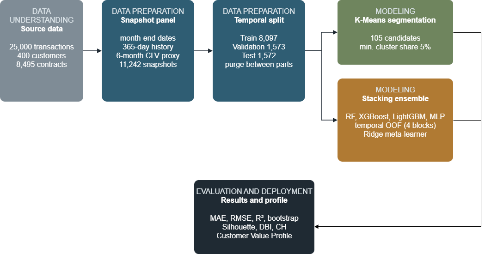
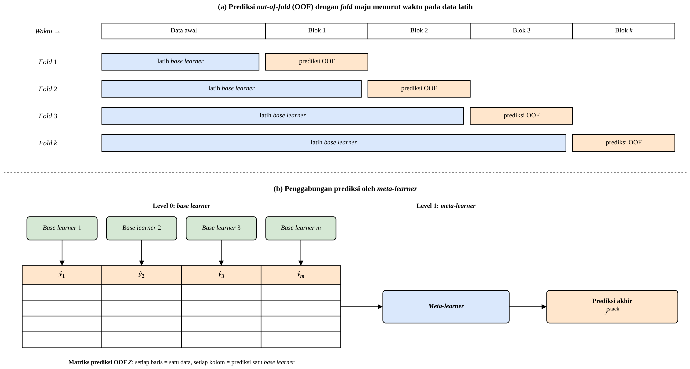

# Customer Lifetime Value Prediction & Segmentation (B2B Coal Sales)

Undergraduate thesis project that combines **K-Means customer segmentation** with a **stacking ensemble** (Random Forest, XGBoost, LightGBM, MLP) to predict a six-month **Customer Lifetime Value (CLV) proxy** for B2B coal customers. The results are served in a **Streamlit prototype** called *Customer Value Profile*.

> All transaction data used here is **synthetic**. Customer names in the app data are pseudonymized (`Customer 0172`, …).



## Highlights

| Task | Metric (Test set) | Result |
|---|---|---|
| CLV proxy regression (stacking ensemble) | R² | **0.7374** |
| Customer segmentation (K-Means, k = 2) | Silhouette | **0.3572** |
| Customer segmentation (K-Means, k = 2) | Davies–Bouldin index | 1.0742 |

- The stacking ensemble beat every base learner on the validation set (R² 0.7188 vs. 0.7124 for LightGBM). On the test set it was statistically better than LightGBM (95% bootstrap CI of the RMSE difference: −34,358 to −4,714 USD), while Random Forest alone scored a similar R² (0.7410).
- Two segments were identified: **high-value active-contract customers** and **infrequent buyers**.
- Base-learner errors are highly correlated (OOF error correlation 0.943–0.985), which limits how much stacking can add. This is discussed in the thesis.

## Method

1. **Data understanding**: 400 customers and 8,495 contracts, transactions from Oct 2021 to Sep 2026.
2. **Data preparation**: monthly customer snapshots (panel data) with RFM-style, contract, price and payment features known at each as-of date. A temporal Train/Validation/Test split with a purge gap prevents look-ahead leakage.
3. **Segmentation**: K-Means with a search over feature sets, scaling and number of clusters (elbow, silhouette, DBI), plus a stability check.
4. **Base learners**: Random Forest, XGBoost, LightGBM and MLP, tuned with time-aware validation inside the training period.
5. **Stacking ensemble**: out-of-fold (OOF) predictions with nested tuning; Ridge meta-learner selected on validation; configuration locked before a single evaluation on Test.
6. **Evaluation**: MAE, RMSE, R², performance per as-of date, paired bootstrap comparison, residual analysis.
7. **Customer Value Profile**: segment label + predicted CLV per customer, exported for the Streamlit app.



## Repository structure

```
.
├── notebooks/
│   └── clv_segmentation_stacking.ipynb   # full pipeline: understanding → preparation → modeling → evaluation
├── app/                                  # Streamlit prototype
│   ├── app.py                            # 3 pages: segment summary, customer profile, prediction from file
│   ├── inference_v3.py                   # loads the model bundle and computes segment + CLV prediction
│   ├── sk_compat.py, xgb_compat.py       # compatibility fixes for loading scikit-learn / XGBoost models on Windows
│   ├── cek_model.py                      # checks that app predictions match the notebook output
│   ├── models/stacking_bundle.joblib     # trained K-Means + base learners + meta-learner
│   └── data/                             # example snapshot and black-box test files (synthetic)
├── docs/figures/                         # pipeline and architecture diagrams
└── requirements.txt
```

## Run the Streamlit app

```bash
python -m venv .venv
.venv\Scripts\activate          # Windows  (macOS/Linux: source .venv/bin/activate)
pip install -r requirements.txt
cd app
streamlit run app.py
```

Then open http://localhost:8501. You can upload `app/data/contoh_snapshot.csv` on the prediction page to try it out. The files in `app/data/uji/` are black-box test cases (valid file, missing columns, wrong file type, one customer on four dates).

To verify that the app reproduces the notebook's predictions:

```bash
cd app
python cek_model.py
```

## Notes

- The notebook was developed in Google Colab. Its narrative and the app's UI text are in Indonesian, the language of the thesis.
- The raw source dataset is not included in this repository.

## Tech stack

Python · pandas · NumPy · scikit-learn · XGBoost · LightGBM · SciPy · Matplotlib · Altair · Streamlit · joblib

## Author

**Farell Eugene**, Information Systems, Universitas Multimedia Nusantara
